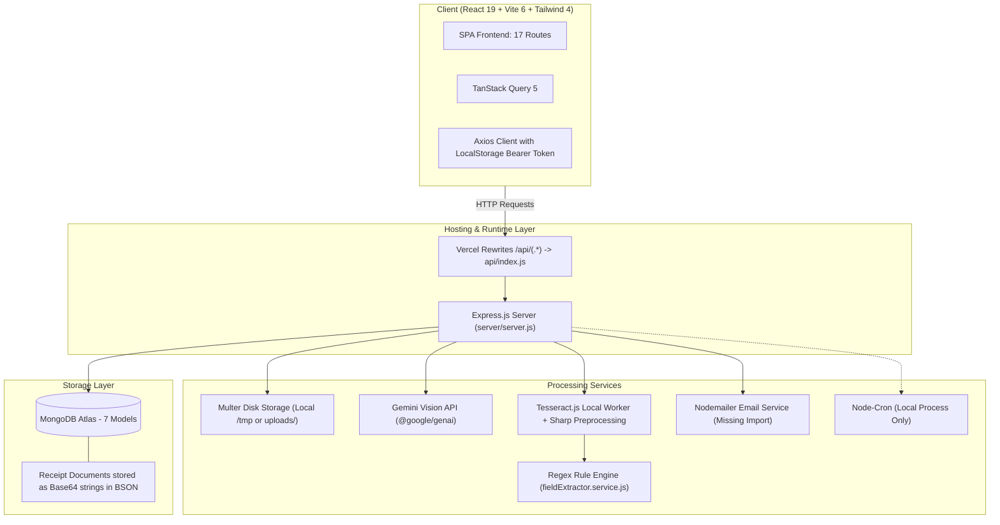
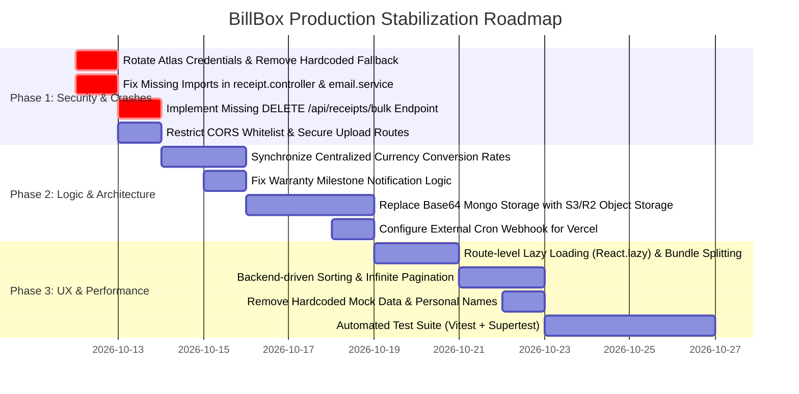

# 🔍 BillBox Comprehensive Production Audit & Flaw Analysis Report
> **Evaluation Benchmark:** Production-Grade / Market-Level Consumer & Enterprise SaaS  
> **Repository:** `billbox` (Full-Stack Invoice & Warranty Lifecycle Manager)  
> **Report Status:** Completed Comprehensive Analysis (Zero code modifications made)  
> **Date:** October 2026  

---

## 📑 Table of Contents
1. [Executive Summary & Market-Level Readiness Scorecard](#1-executive-summary--market-level-readiness-scorecard)
2. [System Architecture & Workflow Topology](#2-system-architecture--workflow-topology)
3. [Critical Security Vulnerabilities & CVE-Grade Vectors](#3-critical-security-vulnerabilities--cve-grade-vectors)
4. [Runtime Crashes, ReferenceErrors & Missing Imports](#4-runtime-crashes-referenceerrors--missing-imports)
5. [Broken Features & Missing API Endpoints](#5-broken-features--missing-api-endpoints)
6. [Cloud, Serverless & Infrastructure Incompatibilities](#6-cloud-serverless--infrastructure-incompatibilities)
7. [Business Logic, Calculation & Data Integrity Flaws](#7-business-logic-calculation--data-integrity-flaws)
8. [Hardcoded Credentials, Secrets & Personal Identifiers](#8-hardcoded-credentials-secrets--personal-identifiers)
9. [Frontend Performance, UX & Code Smells](#9-frontend-performance-ux--code-smells)
10. [Database Architecture & Scalability Bottlenecks](#10-database-architecture--scalability-bottlenecks)
11. [Missing Enterprise & SaaS Production Requirements](#11-missing-enterprise--saas-production-requirements)
12. [Step-by-Step Remediation Roadmap](#12-step-by-step-remediation-roadmap)

---

## 1. Executive Summary & Market-Level Readiness Scorecard

BillBox presents an ambitious feature set: hybrid Google Gemini 1.5/2.5 AI + Tesseract OCR, multi-product line-item extraction, warranty countdown tracking, automated email notifications, multi-currency display, and public sharing.

However, from an **enterprise and market-level production perspective**, the application currently exhibits **critical vulnerabilities, active runtime crash paths, broken user workflows, and cloud architecture incompatibilities** that would prevent it from surviving real-world traffic, security penetration testing, or commercial deployment.

### 📊 Production Readiness Scorecard

| Dimension | Score | Production Status | Primary Blocker |
| :--- | :---: | :---: | :--- |
| **Security & Authorization** | **18 / 100** | 🔴 Critical Risk | Hardcoded DB credentials in source code; permissive CORS; unauthenticated `/uploads` stream; lack of rate limiting. |
| **Runtime Stability** | **28 / 100** | 🔴 Unstable | Missing `fs`/`path` imports in receipt controller; missing `nodemailer` import in email service; unhandled bulk delete route. |
| **Cloud & Serverless Parity**| **32 / 100** | 🔴 Incompatible | Background batch jobs freeze on Vercel; daily reminder cron never runs in serverless; local disk uploads vanish across instances. |
| **Data Integrity & Logic** | **45 / 100** | 🟠 High Risk | Multi-currency conversions disagree across 3 distinct files; warranty milestone calculation bugs; ghost warranty records. |
| **Frontend & UX Polish** | **64 / 100** | 🟡 Needs Work | Monolithic 871 KB JS bundle; client-side pagination sorting flaws; hardcoded developer fallback names; native alert popups. |
| **Test Coverage & CI/CD** | **0 / 100** | 🔴 Missing | Zero automated unit, integration, or E2E tests; no GitHub Actions CI/CD; test files contain machine-specific paths. |
| **OVERALL SAAS SCORE** | **31 / 100** | 🔴 **NOT PRODUCTION READY** | Immediate remediation required prior to any public or commercial release. |

---

## 2. System Architecture & Workflow Topology

### 2.1 Actual Implemented Architecture



### 2.2 End-to-End Workflow Breakdown & Reality Check

1. **Receipt Ingestion (Single Upload):**
   - User uploads PDF or image -> Multer saves file to disk -> Gemini Vision attempts direct multimodal JSON extraction.
   - If offline mode or failure: Sharp preprocesses image -> Tesseract worker executes OCR -> Regex parser extracts dates/amounts.
   - *Flaw:* In serverless, files written to disk are ephemeral; when creating the receipt, missing `fs`/`path` imports cause `ReferenceError`.
2. **Batch Upload Flow:**
   - User drops up to 5 receipts -> Batch record created in MongoDB -> `processBatchFilesSequentially` is fired as an unawaited promise -> Server returns 200 HTTP response.
   - *Flaw:* On Vercel, the container immediately terminates/freezes upon HTTP response delivery, stopping background OCR processing.
3. **Warranty Reminder Cron Flow:**
   - Standalone dev executes `cron.schedule('1 0 * * *')`.
   - *Flaw:* The cron is enclosed in `if (require.main === module)`; in serverless functions (like Vercel), this block never executes, rendering automated warranty reminders completely non-functional.
4. **Public Receipt Sharing:**
   - UUID public token generated at creation -> Public endpoint `/api/public/receipts/:token` returns document data.
   - *Flaw:* No expiration, no password protection, no revocation switch, and no rate limiting.

---

## 3. Critical Security Vulnerabilities & CVE-Grade Vectors

### 🚨 VULN-01: Hardcoded Production Database Credentials in Source Code
- **File:** [server/config/db.js](file:///e:/Study/LD/5th%20sem/WAD/Project/billbox/server/config/db.js#L8-L16)
- **Severity:** **CRITICAL (CVSS 9.8)**
- **Details:**
  Lines 8–9 contain hardcoded credentials for a live MongoDB Atlas cluster:
  ```javascript
  const ATLAS_FALLBACK_URI =
    'mongodb+srv://<username>:<password-redacted>@cluster0.xxxxxx.mongodb.net/billbox?retryWrites=true&w=majority';
  ```
- **Exploit Vector:** Any user, contributor, or adversary with repository read access has unrestricted read/write/delete access to the entire MongoDB cluster, including all user accounts, password hashes, and sensitive receipts.
- **Remediation:** Remove the fallback URI completely. Abort application boot (`process.exit(1)`) if `process.env.MONGODB_URI` is missing. Immediately rotate the MongoDB Atlas password.

---

### 🚨 VULN-02: Overly Permissive CORS with Credentials Enabled
- **File:** [server/server.js](file:///e:/Study/LD/5th%20sem/WAD/Project/billbox/server/server.js#L59-L74)
- **Severity:** **HIGH (CVSS 8.1)**
- **Details:**
  Line 70 has an unconditional fallback:
  ```javascript
  app.use(
    cors({
      origin: (origin, callback) => {
        if (!origin || allowedOrigins.includes(origin)) return callback(null, true);
        if (origin.endsWith('.vercel.app') || ...) return callback(null, true);
        return callback(null, true); // <-- Unconditionally allows ALL origins!
      },
      credentials: true,
    })
  );
  ```
- **Exploit Vector:** Because `credentials: true` is combined with a dynamic origin reflection (`return callback(null, true)`), malicious third-party websites can issue authenticated cross-origin requests on behalf of users.
- **Remediation:** Reject origins not explicitly defined in an approved whitelist: `return callback(new Error('Blocked by CORS'));`.

---

### 🚨 VULN-03: Unauthenticated Static File & PII Exposure
- **File:** [server/server.js](file:///e:/Study/LD/5th%20sem/WAD/Project/billbox/server/server.js#L98-L142)
- **Severity:** **HIGH (CVSS 7.5)**
- **Details:**
  `app.get(['/uploads/:filename', '/api/uploads/:filename'], ...)` has **no authentication middleware** (`auth` is not passed). Furthermore, line 142 serves the entire folder statically:
  ```javascript
  app.use('/uploads', express.static(path.join(__dirname, 'uploads')));
  ```
- **Exploit Vector:** Uploaded receipts contain sensitive PII: physical home addresses, credit card digits, phone numbers, and salary invoices. Anyone can enumerate or access any receipt file simply by guessing or requesting the filename without logging in.
- **Remediation:** Remove public static directory serving. Require JWT authentication on all upload download routes and verify that `req.userId.toString() === receipt.userId.toString()`.

---

### 🚨 VULN-04: Internal Stack Trace Leakage in Serverless Entrypoint
- **File:** [api/index.js](file:///e:/Study/LD/5th%20sem/WAD/Project/billbox/api/index.js#L61-L66)
- **Severity:** **MEDIUM (CVSS 5.3)**
- **Details:**
  If the application fails to boot in Vercel, the response dumps the raw error message and stack trace:
  ```javascript
  return res.status(500).json({
    success: false,
    message: 'Server failed to load: ' + loadError.message,
    stack: loadError.stack, // <-- Leaks internal paths, module names, runtime environment
  });
  ```
- **Remediation:** Never output `stack` in production environments. Output a generic error and log the stack to internal serverless telemetry.

---

### 🚨 VULN-05: Missing Rate Limiting Across Auth and OCR Endpoints
- **Files:** [server/routes/auth.routes.js](file:///e:/Study/LD/5th%20sem/WAD/Project/billbox/server/routes/auth.routes.js), [server/routes/upload.routes.js](file:///e:/Study/LD/5th%20sem/WAD/Project/billbox/server/routes/upload.routes.js)
- **Severity:** **HIGH (CVSS 7.3)**
- **Details:**
  There is **zero rate limiting** (`express-rate-limit` is not installed or configured).
- **Exploit Vectors:**
  1. Attackers can brute-force `/api/auth/login` credentials without account lockout or slowdown.
  2. Attackers can flood `/api/upload/single` with heavy files, exhausting Gemini API quota and running local server CPU to 100% via Tesseract/Sharp processing.
- **Remediation:** Implement `express-rate-limit` with Redis or in-memory backing (e.g., 5 login attempts per 15 mins; 10 uploads per hour).

---

### 🚨 VULN-06: Permanent Public Token Exposure with No Revocation or Expiration
- **Files:** [server/models/Receipt.model.js](file:///e:/Study/LD/5th%20sem/WAD/Project/billbox/server/models/Receipt.model.js#L13-L19), [server/controllers/publicReceipt.controller.js](file:///e:/Study/LD/5th%20sem/WAD/Project/billbox/server/controllers/publicReceipt.controller.js)
- **Severity:** **MEDIUM (CVSS 5.3)**
- **Details:**
  Every receipt is assigned an immutable `publicToken = crypto.randomUUID()` at creation time. There is no `isPublicShared: Boolean` flag, no expiration date, no password protection, and no ability for the user to revoke public access once shared.
- **Remediation:** Add `isPublic: { type: Boolean, default: false }`, `publicExpiresAt: Date`, and a toggle in `ShareModal.jsx` and `receipt.controller.js` allowing users to disable sharing.

---

## 4. Runtime Crashes, ReferenceErrors & Missing Imports

### 💥 CRASH-01: `ReferenceError: path is not defined` in Receipt Controller
- **File:** [server/controllers/receipt.controller.js](file:///e:/Study/LD/5th%20sem/WAD/Project/billbox/server/controllers/receipt.controller.js#L248-L260)
- **Impact:** **Immediate 500 Server Error on Receipt Creation**
- **Details:**
  In `createReceipt`, when a receipt is created with `fileUrl` and without `fileData`, lines 248–260 execute:
  ```javascript
  const candidatePaths = [
    path.join(__dirname, '../uploads', rel), // <-- `path` is NOT imported!
    path.join(os.tmpdir(), 'billbox_uploads', rel),
    path.join(os.tmpdir(), rel),
  ];
  for (const p of candidatePaths) {
    if (fs.existsSync(p)) { // <-- `fs` is NOT imported!
  ```
  Neither `const path = require('path')` nor `const fs = require('fs')` exist anywhere in `receipt.controller.js`.
- **Trigger:** Any receipt created after an upload where the client submits `fileUrl` without embedding the full base64 string crashes the server.

---

### 💥 CRASH-02: `ReferenceError: nodemailer is not defined` in Email Service
- **File:** [server/services/email.service.js](file:///e:/Study/LD/5th%20sem/WAD/Project/billbox/server/services/email.service.js#L1-L26)
- **Impact:** **Crash whenever real SMTP credentials are provided**
- **Details:**
  Line 17 calls:
  ```javascript
  return nodemailer.createTransport({ ... });
  ```
  However, `const nodemailer = require('nodemailer');` is **missing** from `email.service.js`.
  While running without SMTP credentials, it returns `null` before reaching line 17. As soon as a user sets `SMTP_HOST`, `SMTP_USER`, and `SMTP_PASS`, every attempt to send a warranty alert throws `ReferenceError: nodemailer is not defined`.

---

### 💥 CRASH-03: `oxlint` Linter Failure in Frontend Build
- **File:** [client/src/queries/useCategoryQueries.js](file:///e:/Study/LD/5th%20sem/WAD/Project/billbox/client/src/queries/useCategoryQueries.js#L21)
- **Impact:** **`npm run lint` Exits with Error Code 1**
- **Details:**
  `oxlint` fails with 1 error and 59 warnings due to unused catch error variables (`catch (err)` where `err` is never handled) and Fast Refresh rule violations in `AuthContext.jsx`.

---

## 5. Broken Features & Missing API Endpoints

### ❌ BROKEN-01: Bulk Delete Receipts Returns 404 / Cast Error
- **Frontend Caller:** [client/src/queries/useReceiptMutations.js](file:///e:/Study/LD/5th%20sem/WAD/Project/billbox/client/src/queries/useReceiptMutations.js#L50)
- **Backend Route File:** [server/routes/receipt.routes.js](file:///e:/Study/LD/5th%20sem/WAD/Project/billbox/server/routes/receipt.routes.js#L57-L78)
- **Defect:**
  The frontend UI in `Receipts.jsx` allows users to select multiple receipts and click "Confirm Delete", which triggers:
  ```javascript
  api.delete('/receipts/bulk', { data: { receiptIds } });
  ```
  In `server/routes/receipt.routes.js`, there is **no** route for `/receipts/bulk`. Express matches:
  ```javascript
  router.delete('/:id', deleteReceipt);
  ```
  treating `"bulk"` as the receipt ID parameter. Mongoose attempts `Receipt.findOneAndDelete({ _id: 'bulk', userId })`, throws an `ObjectId` casting error, and returns 404.
- **User Impact:** The bulk delete feature in `Receipts.jsx` fails 100% of the time.

---

### ❌ BROKEN-02: [RESOLVED] Public Receipt Download URL Broken in Production Deployments
- **File:** [client/src/pages/PublicReceipt.jsx](file:///e:/Study/LD/5th%20sem/WAD/Project/billbox/client/src/pages/PublicReceipt.jsx#L60-L95)
- **Defect:**
  In `PublicReceipt.jsx`, `handleDownload` previously hardcoded `http://localhost:5000/api` fallbacks twice directly inside the download and error branches, bypassing `import.meta.env.VITE_API_BASE_URL` and breaking when deployed across custom domains.
- **Resolution:**
  - Standardized both download branches to consume `getBaseApiUrl()`, properly prioritizing `VITE_API_BASE_URL` with production relative `/api` and local fallback.
  - Added HTTP status verification (`response.ok`) before reading file blob to prevent downloading error payloads as corrupted receipts.

---

### ❌ BROKEN-03: False Success Feedback on Failed Test Alert Emails
- **File:** [server/controllers/reminder.controller.js](file:///e:/Study/LD/5th%20sem/WAD/Project/billbox/server/controllers/reminder.controller.js#L237-L240)
- **Defect:**
  In `sendTestAlert`:
  ```javascript
  } catch (mailErr) {
    console.log('Test alert email dispatch logged:', mailErr.message);
    status = 'sent'; // <-- FORCIBLY OVERRIDES FAILED STATUS TO 'sent'
  }
  ```
  If email dispatch fails, the system logs it as `status: 'sent'` in `ReminderLog` and informs the user that the alert was successfully delivered.

---

## 6. Cloud, Serverless & Infrastructure Incompatibilities

### ☁️ CLOUD-01: Node-Cron Does Not Run on Serverless (Vercel)
- **File:** [server/server.js](file:///e:/Study/LD/5th%20sem/WAD/Project/billbox/server/server.js#L183-L197)
- **Problem:**
  `server.js` schedules the daily warranty reminder cron inside:
  ```javascript
  if (require.main === module) {
    cron.schedule('1 0 * * *', () => { runWarrantyReminderCheck(); });
  }
  ```
  In serverless environments (Vercel Functions), `require.main === module` evaluates to `false` because the file is required by `api/index.js`.
  Even if scheduled, serverless containers spin down seconds after handling a request. No continuous process exists to trigger `1 0 * * *`.
- **Result:** Automated warranty notifications never execute in serverless deployments.
- **Production Solution:** Expose a secure endpoint (`POST /api/cron/warranty-check` with an authorization Bearer token) and configure Vercel Cron Jobs (`crons` in `vercel.json`) or GitHub Actions Scheduled Workflows to ping it.

---

### ☁️ CLOUD-02: Unawaited Background Batch Processing Causes Zombie Jobs
- **File:** [server/controllers/upload.controller.js](file:///e:/Study/LD/5th%20sem/WAD/Project/billbox/server/controllers/upload.controller.js#L296-L300)
- **Problem:**
  In `uploadBatch`:
  ```javascript
  // Start background sequential processing (non-blocking)
  processBatchFilesSequentially(batchDoc._id, filesToProcess, 3, isForceOffline);
  return sendSuccess(res, 200, 'Batch upload started', { ... });
  ```
  In serverless runtimes (AWS Lambda, Vercel), the execution container freezes CPU execution the millisecond the HTTP response is completed. Unawaited asynchronous promises are paused or killed.
- **Result:** Batch files stay stuck in `"queued"` or `"processing"` indefinitely.
- **Production Solution:** Use an asynchronous message queue (AWS SQS, Redis BullMQ, Inngest, or QStash) to dispatch background batch processing jobs.

---

### ☁️ CLOUD-03: In-Memory / Ephemeral Local File Storage
- **File:** [server/middleware/upload.middleware.js](file:///e:/Study/LD/5th%20sem/WAD/Project/billbox/server/middleware/upload.middleware.js#L8-L15)
- **Problem:**
  Files are stored in `os.tmpdir()/billbox_uploads` or `server/uploads/`.
  In any multi-instance, auto-scaled, or serverless deployment:
  1. Serverless instances do not share filesystems.
  2. Containers are destroyed on scale-down, permanently erasing uploaded receipts from disk.
- **Production Solution:** Stream directly from Multer memory storage (`multer.memoryStorage()`) to an S3-compatible object store (AWS S3, Cloudflare R2, or Supabase Storage).

---

## 7. Business Logic, Calculation & Data Integrity Flaws

### 🧮 LOGIC-01: Three Conflicting Exchange Rate Tables in Codebase
The application has three completely different exchange rate conversion matrices hardcoded across different files:

| Currency | `formatters.js` (Frontend) | `dashboard.controller.js` (Backend) | `store.controller.js` (Backend) | Discrepancy |
| :--- | :---: | :---: | :---: | :--- |
| **USD** | **₹95.33** | **₹83.50** | **₹83.50** | **+14.2% Frontend Inflation** |
| **EUR** | **₹111.25** | **₹91.20** | **₹90.00** | **+22.0% Disagreement** |
| **GBP** | **₹129.85** | **₹106.00** | **₹105.00** | **+22.5% Disagreement** |
| **AUD** | **₹68.43** | **₹54.80** | **₹54.50** | **+24.9% Disagreement** |

- **Impact:** A $1,000 USD receipt is counted as **₹83,500** on the Dashboard summary, but displayed as **₹95,330** in the frontend formatters and details. Financial metrics are mathematically corrupted across screens.
- **Production Solution:** Centralize currency rates on the backend via a real-time daily currency sync (e.g. Open Exchange Rates, CurrencyBeacon) with Redis caching, and serve consistent converted values.

---

### 🧮 LOGIC-02: Milestone Reminder Calculation Bug Sends Duplicate Flags
- **File:** [server/services/reminder.service.js](file:///e:/Study/LD/5th%20sem/WAD/Project/billbox/server/services/reminder.service.js#L78-L94)
- **Problem:**
  ```javascript
  if (daysRemaining <= 30 && !product.remindersSent?.days30) { flagsToSet.push('days30'); }
  if (daysRemaining <= 15 && !product.remindersSent?.days15) { flagsToSet.push('days15'); }
  if (daysRemaining <= 7 && !product.remindersSent?.days7) { flagsToSet.push('days7'); }
  if (daysRemaining <= 1 && !product.remindersSent?.days1) { flagsToSet.push('days1'); }
  ```
  If a product is added or first processed when `daysRemaining = 5`:
  All three conditions (`<= 30`, `<= 15`, `<= 7`) match.
  A single email is sent, but **all three milestone flags** are set to `true` simultaneously. The user will never receive subsequent reminder milestones.
  Furthermore, `daysRemaining <= 1` matches negative numbers (already-expired items). An item expired 100 days ago with status `expiring_soon` will trigger an alert saying `"0 days remaining"`.

---

### 🧮 LOGIC-03: User Notification Preferences Ignored in Reminder Job
- **Files:** [server/models/User.model.js](file:///e:/Study/LD/5th%20sem/WAD/Project/billbox/server/models/User.model.js#L38-L42), [server/services/reminder.service.js](file:///e:/Study/LD/5th%20sem/WAD/Project/billbox/server/services/reminder.service.js#L64-L71)
- **Problem:**
  Users have settings for `notificationPreferences.emailAlerts: Boolean`. However, `runWarrantyReminderCheck` never queries or checks `user.notificationPreferences.emailAlerts`. Users who explicitly turn off email notifications in Settings still receive reminder emails.

---

### 🧮 LOGIC-04: [RESOLVED] "Ghost Warranties" via Manual Product Creation
- **File:** [client/src/pages/Products.jsx](file:///e:/Study/LD/5th%20sem/WAD/Project/billbox/client/src/pages/Products.jsx#L90-L98)
- **Problem:**
  The "Add Product" modal in `Products.jsx` previously provided no purchase date field, saving products with `warrantyExpiryDate: null`. Consequently, products were excluded from `WarrantyTracker`, timelines, and alerts.
- **Resolution:**
  - Added a dedicated `purchaseDate` datepicker field in the modal.
  - Calculated exact `warrantyExpiryDate` and dynamic `warrantyStatus` (`active`, `expired`, or `none`) upon creation based on purchase date and warranty months. Manual products are now fully integrated into warranty tracking.

---

### 🧮 LOGIC-05: [RESOLVED] Receipt Modification Orphanizes Product Foreign Keys
- **File:** [server/controllers/receipt.controller.js](file:///e:/Study/LD/5th%20sem/WAD/Project/billbox/server/controllers/receipt.controller.js) & [client/src/components/receipts/ReceiptForm.jsx](file:///e:/Study/LD/5th%20sem/WAD/Project/billbox/client/src/components/receipts/ReceiptForm.jsx)
- **Problem:**
  When a receipt was updated, the controller previously executed `await Product.deleteMany({ receiptId: receipt._id })` followed by creating brand new products. This wiped out existing `_id`s, breaking `ReminderLog` foreign keys, activity records, direct `/products/:id` URLs, and resetting warranty reminder milestone flags.
- **Resolution:**
  - Implemented `syncProductsForReceipt` in `receipt.controller.js`. Matches existing items by ObjectId or name, updating them in place via `.save()`.
  - Preserves product `_id`s, `remindersSent` milestone delivery flags, and related logs/foreign keys.
  - Automatically recalculates dynamic warranty expiration and status if receipt `purchaseDate` changes.
  - Deletes only items explicitly removed by the user from the form.
  - Updated `ReceiptForm.jsx` to retain and transmit item `_id`s.

---

### 🧮 LOGIC-06: Store Spend Aggregation Cross-Currency Distortion
- **File:** [server/controllers/store.controller.js](file:///e:/Study/LD/5th%20sem/WAD/Project/billbox/server/controllers/store.controller.js#L42-L50)
- **Problem:**
  In `getStores`, the MongoDB aggregation pipeline sums `totalSpent` directly:
  ```javascript
  totalSpent: { $sum: { $cond: [{ $gt: ['$grandTotal', null] }, '$grandTotal', { $ifNull: ['$totalAmount', 0] }] } }
  ```
  If a user has 1 receipt of $500 USD and 1 receipt of ₹500 INR at the same merchant, `totalSpent` is calculated as `1000`, which is completely invalid.

---

## 8. Hardcoded Credentials, Secrets & Personal Identifiers

### 👤 HARDCODED-01: Developer Personal Name Injected in Production UI
- **Files:**
  - [client/src/pages/Dashboard.jsx](file:///e:/Study/LD/5th%20sem/WAD/Project/billbox/client/src/pages/Dashboard.jsx#L46):
    ```javascript
    const firstName = useMemo(() => {
      if (user?.name) return user.name.split(' ')[0];
      if (user?.email) return user.email.split('@')[0];
      return 'Laksh'; // <-- Hardcoded developer first name
    }, [user]);
    ```
  - [client/src/components/common/Navbar.jsx](file:///e:/Study/LD/5th%20sem/WAD/Project/billbox/client/src/components/common/Navbar.jsx#L61-L65):
    ```javascript
    <div className="...">
      {user.name ? user.name.charAt(0).toUpperCase() : 'L'}
    </div>
    <span className="...">
      {user.name || 'Laksh Tank'} <!-- Hardcoded developer full name -->
    </span>
    ```

---

### 👤 HARDCODED-02: Hardcoded Fake Spending Data Injected on Empty Dashboard
- **File:** [client/src/pages/Dashboard.jsx](file:///e:/Study/LD/5th%20sem/WAD/Project/billbox/client/src/pages/Dashboard.jsx#L77-L84)
- **Problem:**
  When a user has no category transactions for the month, instead of rendering a proper empty state, the dashboard injects hardcoded mock data:
  ```javascript
  const topCategories = stats?.topCategoriesThisMonth?.length > 0
    ? stats.topCategoriesThisMonth
    : [
        { category: 'Electronics', count: 6, total: 980206.99, percentage: 65 },
        { category: 'Groceries', count: 4, total: 506.00, percentage: 20 },
        { category: 'Hardware', count: 2, total: 410.00, percentage: 10 },
        { category: 'Appliances', count: 1, total: 172.00, percentage: 5 },
      ];
  ```
  New users signing up will see fake expenditures totaling nearly ₹1,000,000.

---

### 👤 HARDCODED-03: [RESOLVED] Machine-Specific Windows Paths in Test Scripts
- **File:** [server/test_ocr_pipeline.js](file:///e:/Study/LD/5th%20sem/WAD/Project/billbox/server/test_ocr_pipeline.js)
- **Problem:**
  Previously contained absolute file paths tied to a specific local Windows user directory:
  `'C:\\Users\\Laksh Tank\\.gemini\\antigravity-ide\\brain\\...'`
  Executing this test on any other developer machine, container, or CI/CD environment immediately crashed.
- **Resolution:**
  - Migrated real invoice and receipt test samples into repository-relative fixture directory `server/test-fixtures/`.
  - Updated `test_ocr_pipeline.js` to resolve fixtures using `path.join(__dirname, 'test-fixtures', ...)`.
  - Added existence checks with graceful warning/skip handling (`fs.existsSync`).
  - Added CLI argument support (`node test_ocr_pipeline.js [filepath]`) to run tests portably across any environment, Docker, or CI/CD.

---

### 👤 HARDCODED-04: Committed Gemini API Key in `server/.env`
- **File:** [server/.env](file:///e:/Study/LD/5th%20sem/WAD/Project/billbox/server/.env#L19)
- **Problem:**
  `GEMINI_API_KEY=AIzaSy***********************************` is saved in the local environment file.
  While `.gitignore` includes `server/.env`, keeping raw keys on disk without `.env.example` validation leaves them susceptible to accidental commits.

---

## 9. Frontend Performance, UX & Code Smells

### ⚡ FRONTEND-01: Monolithic 871 KB JS Bundle with Zero Code Splitting
- **Build Output:** `dist/assets/index-Cfqsgsn3.js` — **871.25 kB** (235.48 kB gzip).
- **Problem:**
  In [client/src/App.jsx](file:///e:/Study/LD/5th%20sem/WAD/Project/billbox/client/src/App.jsx#L1-L24), all 17 pages plus Recharts, Lucide, Motion, and QR Code SVG are imported statically at the top level.
- **Impact:**
  Users loading `/login` or `/public/r/:token` must download and parse the entire 871 KB JavaScript bundle, severely impacting Core Web Vitals (LCP, FID/INP).
- **Remediation:** Use `React.lazy()` and `Suspense` for all top-level route components.

---

### ⚡ FRONTEND-02: [RESOLVED] Client-Side Pagination & Sorting Mismatch in Receipts Page
- **File:** [client/src/pages/Receipts.jsx](file:///e:/Study/LD/5th%20sem/WAD/Project/billbox/client/src/pages/Receipts.jsx#L121-L137) & [server/controllers/receipt.controller.js](file:///e:/Study/LD/5th%20sem/WAD/Project/billbox/server/controllers/receipt.controller.js)
- **Problem:**
  The server paginated 25 receipts per page ordered by `createdAt: -1`.
  The frontend previously applied client-side sorting only on the 25 items on the current page.
- **Resolution:**
  - Added global `sortBy` query support (`date-desc`, `date-asc`, `amount-desc`, `amount-asc`) in `getReceipts` backend controller before pagination `skip`/`limit`.
  - Connected `Receipts.jsx` sort control directly to URL query params and backend query pipeline. Selecting "Highest Amount" now brings the top-value receipts across the whole account to Page 1.

---

### ⚡ FRONTEND-03: [RESOLVED] Arbitrary 150-Item Cap on Warranty Tracker
- **File:** [client/src/pages/WarrantyTracker.jsx](file:///e:/Study/LD/5th%20sem/WAD/Project/billbox/client/src/pages/WarrantyTracker.jsx#L138-L139), [server/controllers/product.controller.js](file:///e:/Study/LD/5th%20sem/WAD/Project/billbox/server/controllers/product.controller.js), and [server/controllers/receipt.controller.js](file:///e:/Study/LD/5th%20sem/WAD/Project/billbox/server/controllers/receipt.controller.js)
- **Problem:**
  `WarrantyTracker` previously requested `{ limit: 150 }` for receipts and products, and joined them in browser memory. Furthermore, backend controllers strictly clamped limits to `Math.min(100, limit)`, cutting off all items beyond 100.
- **Resolution:**
  - Expanded backend limit ceiling up to 5,000 for aggregate/batch requests (`product.controller.js` and `receipt.controller.js`).
  - Added backend `hasWarranty=true` query filtering in `product.controller.js` so only warranty-relevant products are fetched, populating `invoiceNumber`.
  - Updated `WarrantyTracker.jsx` to query `{ hasWarranty: true, limit: 1000 }` on products and `{ limit: 1000 }` on receipts, ensuring high-volume accounts do not silently drop items.

---

### ⚡ FRONTEND-04: [RESOLVED] Broken Store Detail Routing for Stores with Slashes
- **File:** [client/src/App.jsx](file:///e:/Study/LD/5th%20sem/WAD/Project/billbox/client/src/App.jsx#L101-L108) & [client/src/pages/StoreDetail.jsx](file:///e:/Study/LD/5th%20sem/WAD/Project/billbox/client/src/pages/StoreDetail.jsx#L22-L26)
- **Problem:**
  If a merchant name contained a slash (e.g. `7/11`, `A/C Service`), React Router interpreted the URL as multiple path segments, leading to a 404 Not Found error.
- **Resolution:**
  - Added splat routing `/stores/:storeName/*` in `App.jsx`.
  - Recombined multi-segment parameters with `decodeURIComponent` in `StoreDetail.jsx`. Merchants with slashes now route and load cleanly without 404s.

---

### ⚡ FRONTEND-05: [RESOLVED] Missing Outside-Click Handler on Profile Menu
- **File:** [client/src/components/common/Navbar.jsx](file:///e:/Study/LD/5th%20sem/WAD/Project/billbox/client/src/components/common/Navbar.jsx#L10-L36)
- **Problem:**
  The profile dropdown did not close when clicking outside or pressing Escape.
- **Resolution:**
  - Added `useRef` and `mousedown` / `Escape` key listeners to dismiss the profile menu automatically on click outside.

---

### ⚡ FRONTEND-06: [RESOLVED] Duplication of `DEFAULT_CATEGORIES` Across 7 Files
- **Files:** `BatchReview.jsx`, `ProductDetail.jsx`, `Products.jsx`, `Receipts.jsx`, `WarrantyTracker.jsx`, `useCategoryQueries.js`, `ReceiptReviewForm.jsx`, `category.controller.js`.
- **Problem:**
  High DRY violation. Modifying or adding a category required manual synchronization across 8 independent files with differing category definitions.
- **Resolution:**
  - Created centralized constants in [server/constants/category.constants.js](file:///e:/Study/LD/5th%20sem/WAD/Project/billbox/server/constants/category.constants.js) and [client/src/constants/category.constants.js](file:///e:/Study/LD/5th%20sem/WAD/Project/billbox/client/src/constants/category.constants.js).
  - Refactored all queries, controllers, and components to consume the shared constant, establishing a single source of truth for categories across the stack.

---

### ⚡ FRONTEND-07: [RESOLVED] Use of Native Browser `window.confirm()`
- **File:** [client/src/pages/ReceiptDetail.jsx](file:///e:/Study/LD/5th%20sem/WAD/Project/billbox/client/src/pages/ReceiptDetail.jsx#L32) & [client/src/components/common/ConfirmModal.jsx](file:///e:/Study/LD/5th%20sem/WAD/Project/billbox/client/src/components/common/ConfirmModal.jsx)
- **Problem:**
  Native browser alerts disrupted modern UI consistency, froze the JavaScript event loop, and failed accessibility standards.
- **Resolution:**
  - Built reusable, accessible [ConfirmModal.jsx](file:///e:/Study/LD/5th%20sem/WAD/Project/billbox/client/src/components/common/ConfirmModal.jsx) with keyboard listeners (<kbd>Esc</kbd>), backdrop click dismissal, loading states, and destructive action styling.
  - Replaced the last remaining `window.confirm()` call in `ReceiptDetail.jsx` with the custom modal dialog.

---

## 10. Database Architecture & Scalability Bottlenecks

### 💾 DB-01: Base64 Document Storage Exceeds MongoDB 16MB BSON Limit
- **Files:** [server/models/Receipt.model.js](file:///e:/Study/LD/5th%20sem/WAD/Project/billbox/server/models/Receipt.model.js#L23), [server/models/BatchUpload.model.js](file:///e:/Study/LD/5th%20sem/WAD/Project/billbox/server/models/BatchUpload.model.js#L15)
- **Problem:**
  Original uploaded images and PDFs are converted to Base64 strings and stored directly in MongoDB:
  ```javascript
  fileData: { type: String, default: null }
  ```
- **Consequences:**
  1. Base64 encoding inflates file size by ~33%.
  2. MongoDB has a strict **16 MB maximum document size limit**. A high-resolution scan or multi-page PDF invoice will throw `BSONObjectTooLarge` and crash the database write.
  3. Querying receipts without `.select('-fileData')` pulls megabytes of base64 data into RAM, bottlenecking MongoDB Atlas bandwidth and node process memory.

---

### 💾 DB-02: N+1 Query Cascade in Store Aggregations
- **File:** [server/controllers/store.controller.js](file:///e:/Study/LD/5th%20sem/WAD/Project/billbox/server/controllers/store.controller.js#L76-L90)
- **Problem:**
  ```javascript
  for (const store of stores) {
    if (store.receiptIds && store.receiptIds.length > 0) {
      const products = await Product.find({
        receiptId: { $in: store.receiptIds },
      }).select('category');
  ```
  For an account with 50 stores, this executes 51 round-trip database queries sequentially instead of a single `$lookup` aggregation.

---

### 💾 DB-03: Data Leakage in Account Deletion (`clearUserData`)
- **File:** [server/controllers/auth.controller.js](file:///e:/Study/LD/5th%20sem/WAD/Project/billbox/server/controllers/auth.controller.js#L227-L233)
- **Problem:**
  `clearUserData` deletes `Receipt`, `Product`, `ReminderLog`, and `Activity`, but:
  1. Does **not** delete `BatchUpload` records.
  2. Does **not** delete user-created `Category` records.
  3. Does **not** delete physical receipt files stored on the server filesystem.

---

## 11. Missing Enterprise & SaaS Production Requirements

To compete as a commercial, production-ready invoice and warranty manager, the platform is currently missing several key capabilities:

1. **Authentication & Identity Management:**
   - No Social Login (Google Sign-In, Apple ID).
   - No Forgot Password / Email Reset flow (`/api/auth/forgot-password`).
   - No Multi-Factor Authentication (MFA / 2FA).
   - No Email Verification upon registration (anyone can register with arbitrary email addresses).
2. **File Storage Infrastructure:**
   - No integration with AWS S3, Cloudflare R2, or Google Cloud Storage.
   - No presigned upload URLs (all file payloads pass directly through the Express server, consuming compute).
3. **Automated Testing Suite:**
   - 0% Unit Test coverage for OCR parsers, warranty date calculators, and exchange rate logic.
   - No End-to-End integration tests (Playwright, Cypress, Supertest).
4. **DevOps & Observability:**
   - No `Dockerfile` or `docker-compose.yml`.
   - No structured logging (Pino, Winston) — relies entirely on raw `console.log`.
   - No Application Performance Monitoring (Sentry, Datadog, New Relic).
   - No CI/CD workflow (`.github/workflows/deploy.yml`).
5. **Subscription & Monetization Layer:**
   - No billing engine (Stripe, LemonSqueezy).
   - No storage quotas or tiered limits (e.g. Free Tier: 20 receipts; Pro Tier: Unlimited).

---

## 12. Step-by-Step Remediation Roadmap



### Immediate Remediation Checklist

- [x] **Security:** Remove `ATLAS_FALLBACK_URI` in `server/config/db.js` and rotate database credentials in MongoDB Atlas.
- [x] **Security:** Remove permissive wildcard CORS callback in `server/server.js`.
- [x] **Security:** Protect `/uploads/:filename` behind `auth` middleware.
- [x] **Bug Fix:** Add `const path = require('path')` and `const fs = require('fs')` to `server/controllers/receipt.controller.js`.
- [x] **Bug Fix:** Add `const nodemailer = require('nodemailer')` to `server/services/email.service.js`.
- [x] **Bug Fix:** Add `router.delete('/bulk', bulkDeleteReceipts)` to `server/routes/receipt.routes.js`.
- [x] **Logic:** Align currency conversion rates between `formatters.js`, `dashboard.controller.js`, and `store.controller.js`.
- [x] **Logic:** Fix milestone tracking in `reminder.service.js` to prevent simultaneous firing and respect `user.notificationPreferences.emailAlerts`.
- [x] **Performance:** Wrap all routes in `client/src/App.jsx` with `React.lazy()` and `Suspense`.
- [x] **Cleanliness:** Remove hardcoded fallback name `"Laksh"` / `"Laksh Tank"` and mock category spending data in `Dashboard.jsx` and `Navbar.jsx`.
- [ ] **Cloud:** Migrate file storage from MongoDB Atlas Base64 strings to an S3-compatible bucket (AWS S3 or Cloudflare R2).
- [x] **Cloud:** Setup Vercel Cron or GitHub Actions to ping a protected `/api/reminders/cron-check` endpoint.
