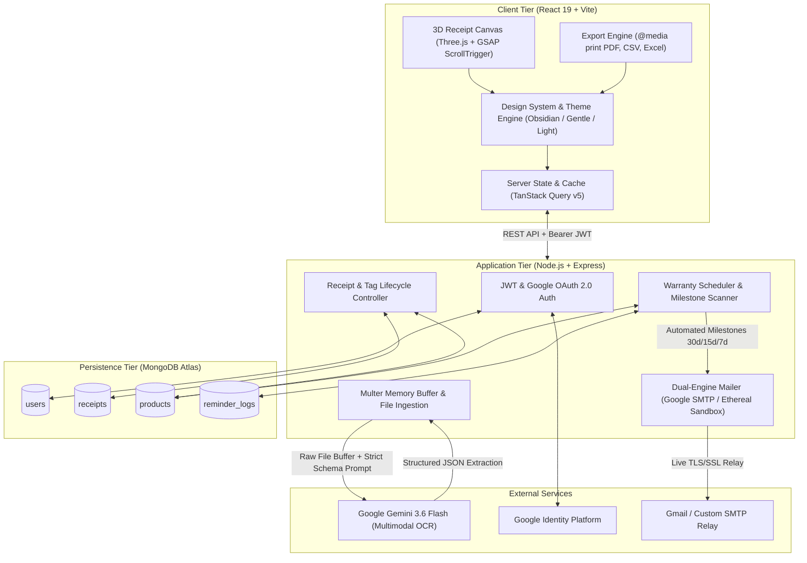
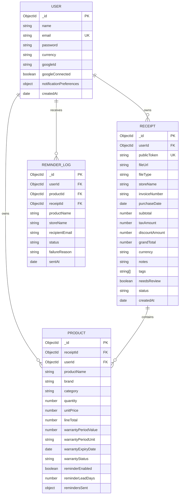

# BillBox
### Smart Digital Invoice, Receipt & Warranty Lifecycle Manager

BillBox is an enterprise-grade digital asset vault and expense intelligence platform designed to eliminate lost paper invoices and expired warranty claims. Utilizing Google Gemini Multimodal AI for zero-shot document parsing, Three.js and GSAP for interactive spatial rendering, and an automated background milestone scheduler, BillBox transforms physical paper slips and digital invoices into indexed, searchable, and actionable financial assets.

---

## 1. System Architecture



---

## 2. Core Capabilities

### 2.1 Multimodal AI Extraction Pipeline
- **Zero-Shot Document Understanding**: Ingests raster images (`.jpeg`, `.png`, `.webp`) and multi-page digital PDFs (`.pdf`).
- **Structured Entity Parsing**: Leverages Google Gemini 3.6 Flash with strict JSON schema enforcement to extract:
  - Vendor / Merchant Name
  - Invoice & Bill Identifiers
  - Purchase Date & Payment Method
  - Line-Item Array (Product, Brand, Category, Quantity, Unit Price, Line Total)
  - Tax Breakdown (CGST/SGST/VAT) & Applied Discounts
  - Manufacturer Warranty Duration & Computed Expiration Dates
- **Confidence Scoring & Anomaly Detection**: In-flight mathematical reconciliation of subtotal + taxes - discounts against grand total. When arithmetic disparities or low visual clarity occur, records are automatically flagged with `needsReview: true`.

### 2.2 Warranty Horizon Engine & Dual-Engine Mailer
- **Live Expiry Calculation**: Continuously evaluates days-to-expiration across all indexed line items with 4 visual status tiers:
  - **Critical**: $\le$ 30 days remaining
  - **Attention**: 31 – 90 days remaining
  - **Moderate**: 91 – 180 days remaining
  - **Protected**: > 180 days remaining
- **Milestone Notification Cadence**: Evaluates proactive dispatches at 30-day, 15-day, and 7-day checkpoints.
- **Dual-Engine Delivery Architecture**:
  - **Live Production Mode**: Direct TLS/SSL dispatch via configured Google SMTP (using App Passwords) or custom enterprise relays (SendGrid, AWS SES, Brevo).
  - **Active Sandbox Fallback**: When SMTP is unconfigured, automatically provisions an active Ethereal mailer account, dispatches the structured HTML template, and returns a verified web inspection URL.
- **Interactive Email Previewer**: Client-side modal allowing users to inspect the exact high-fidelity warranty alert email, review recipient metadata, and trigger live test dispatches.

### 2.3 Smart Tagging & Custom Classification
- **Multi-Tag Indexing**: Receipts support tag arrays (`#Business`, `#TaxDeductible`, `#Personal`, `#Hardware`, `#Office`, `#Travel`) indexed in MongoDB.
- **Instant URL-Synchronized Filtering**: Ribbon bar on `/receipts` enables single-click multi-tag filtering with automatic `?tag=` state management.
- **Inline Tag Editor**: Add and remove classification tags directly from receipt detail cards without entering edit mode.

### 2.4 Advanced Export Suite
- **1-Click Formatted PDF Expense Reports**: Standalone `@media print` layout engine rendering invoice summaries, KPI metric cards, tax breakdowns, and itemized product tables directly into standard printable PDF format without server overhead.
- **Tabular Data Portability**: Client-side RFC 4180 compliant CSV and Excel (`.xls`) generators with configurable columns (itemized products, GST/taxes, and warranty expiration statuses).

### 2.5 Spatial 3D Landing Page
- **Scroll-Bound Physical Simulation**: Built using Three.js and GSAP ScrollTrigger. A realistic 3D invoice model responds dynamically to viewport scrolling, animating pitch, yaw, translation, and fold states across features.
- **Zero Layout Shift**: Strict aspect-ratio preservation and hardware-accelerated WebGL rendering optimized for 60fps across mobile and desktop viewports.

---

## 3. Technology Stack

### Frontend Architecture
| Layer | Technologies | Justification |
| :--- | :--- | :--- |
| **Core Framework** | React 19, Vite 6 | Maximum runtime performance, modern Hooks architecture, and instant HMR. |
| **3D & Animation** | Three.js, GSAP ScrollTrigger, Motion.dev | High-framerate spatial rendering and fluid scroll-bound timeline synchronization. |
| **Server State** | TanStack Query v5 | Multi-tier caching, background revalidation, optimistic updates, and query deduplication. |
| **Styling & Tokens** | Vanilla CSS Tokens, Tailwind CSS v4 | Strict tokenized design system supporting Obsidian Dark, Gentle, and Clean Light palettes. |
| **Routing** | React Router v7 | Native View Transitions and declarative layout routing. |
| **Icons & UI** | Lucide React, Radix UI Primitives | Accessible headless components and consistent vector iconography. |

### Backend Architecture
| Layer | Technologies | Justification |
| :--- | :--- | :--- |
| **Runtime & Server** | Node.js v20+, Express.js 4.21 | Asynchronous non-blocking I/O with robust middleware ecosystem. |
| **AI Inference** | Google GenAI SDK (Gemini 3.6 Flash) | Sub-second latency, multimodal parsing, and strict JSON output compliance. |
| **Database & ODM** | MongoDB Atlas, Mongoose 8.x | Flexible document schema accommodating diverse invoice structures with compound indexes. |
| **Authentication** | JSON Web Tokens (JWT), Bcrypt.js, Google Auth Library | Stateless authentication with OAuth 2.0 federation. |
| **Mail Dispatch** | Nodemailer | Universal transport protocol supporting SMTP, TLS/SSL, and Ethereal sandbox fallbacks. |
| **File Handling** | Multer | In-memory stream processing and multipart/form-data ingestion. |

---

## 4. Database Schema & Data Models



---

## 5. REST API Specification

### 5.1 Authentication (`/api/auth`)
- `POST /api/auth/register` — Registers a new user account with hashed credentials.
- `POST /api/auth/login` — Authenticates credentials and returns a signed JWT.
- `POST /api/auth/google` — Verifies Google ID tokens and creates or links accounts.
- `GET /api/auth/me` — Fetches current user profile and session validity.

### 5.2 Receipt Management (`/api/receipts`)
- `GET /api/receipts` — Paginated receipts list. Supports `search`, `category`, `status`, `tag`, and `sortBy`.
- `POST /api/receipts` — Manually creates a receipt record with itemized products and tags.
- `GET /api/receipts/:id` — Retrieves a single receipt with associated line items and document references.
- `PUT /api/receipts/:id` — Updates receipt metadata, status, tags, and product associations.
- `DELETE /api/receipts/:id` — Deletes a receipt and unlinks associated products.
- `POST /api/receipts/bulk-delete` — Deletes an array of receipt IDs in a single atomic transaction.
- `POST /api/receipts/bulk-category` — Updates categories across multiple receipts simultaneously.

### 5.3 AI Ingestion & Upload (`/api/upload`)
- `POST /api/upload/single` — Ingests a receipt image/PDF, executes Gemini 3.6 Flash extraction, and returns structured data.
- `POST /api/upload/batch` — Processes multi-file batches for sequential background ingestion.

### 5.4 Warranty & Reminders (`/api/reminders`)
- `GET /api/reminders` — Fetches all warranty-tracked products, status distributions, and dispatch history.
- `POST /api/reminders/scan-now` — Triggers an on-demand milestone evaluation across all tracked warranties.
- `POST /api/reminders/configure-smtp` — Validates connection parameters (`host`, `port`, `user`, `pass`) and persists verified credentials.
- `GET /api/reminders/preview-email/:productId` — Generates a preview payload for an alert template.
- `POST /api/reminders/:productId/test` — Dispatches a test alert via live SMTP or the Ethereal sandbox.
- `GET /api/reminders/cron-check` — Public-facing webhook protected by `CRON_SECRET` for serverless cron jobs (e.g. Vercel Cron).

---

## 6. Security & Engineering Highlights

1. **Stateless JWT & Secure Tokenization**: Authentication tokens are signed with HMAC-SHA256 and verified through modular Express middleware. Public document sharing uses non-sequential UUIDv4 tokens (`/public/r/:token`), preventing ID enumeration attacks.
2. **Safe Credential Protocol**: SMTP connection updates trigger an active `transporter.verify()` handshake prior to updating environment configuration, ensuring malformed credentials cannot crash background workers.
3. **Resilient Error Logging**: The backend catches unhandled exceptions and promise rejections with complete stack trace logging, preventing silent process termination.
4. **Client-Side Virtualization & Debouncing**: Receipt tables and search filters use debounced state updates and layout grouping to prevent render thrashing during high-volume data entry.

---

## 7. Local Development Setup

### Prerequisites
- **Node.js**: v20.x or higher
- **MongoDB**: Local MongoDB instance (port 27017) or MongoDB Atlas connection URI
- **Google Gemini API Key**: Free tier or paid key from [Google AI Studio](https://aistudio.google.com/)

### Step 1: Clone Repository & Install Dependencies
```bash
git clone https://github.com/lakshtank/billbox.git
cd billbox

# Install server dependencies
cd server
npm install

# Install client dependencies
cd ../client
npm install
```

### Step 2: Environment Configuration

Create `server/.env`:
```env
PORT=5000
MONGODB_URL=mongodb://127.0.0.1:27017/billbox
JWT_SECRET=your_super_secret_jwt_key_2026
JWT_EXPIRES_IN=7d
CLIENT_URL=http://localhost:5173

# Google Gemini API
GEMINI_API_KEY=your_gemini_api_key_here
GEMINI_MODEL=gemini-3.6-flash

# Optional: Live Google SMTP Relay (Omit for Ethereal Sandbox mode)
# SMTP_HOST=smtp.gmail.com
# SMTP_PORT=465
# SMTP_USER=your_email@gmail.com
# SMTP_PASS=your_16_digit_google_app_password
# EMAIL_FROM="BillBox Vault" <your_email@gmail.com>
```

Create `client/.env`:
```env
VITE_API_URL=http://localhost:5000/api
VITE_GOOGLE_CLIENT_ID=your_google_oauth_client_id.apps.googleusercontent.com
```

### Step 3: Seed Demonstration Data
Populate realistic receipts, line items, warranties, and smart tags:
```bash
cd server
node ../scripts/seed_test_receipts.js
```

### Step 4: Run Development Servers
In two separate terminal windows:
```bash
# Terminal 1: Backend API (port 5000)
cd server
npm run dev

# Terminal 2: Frontend Client (port 5173)
cd client
npm run dev
```

Visit `http://localhost:5173` in your browser.

---

## 8. Production Deployment

### Option A: Monorepo Deployment (Vercel)
BillBox includes root-level `vercel.json` orchestration for unified serverless deployment:
1. Push your repository to GitHub.
2. Import the repository in [Vercel](https://vercel.com).
3. Set the Root Directory to `./`.
4. Configure environment variables (`MONGODB_URL`, `JWT_SECRET`, `GEMINI_API_KEY`, `CLIENT_URL`) in the Vercel dashboard.
5. Deploy.

### Option B: Split Production (Render / Railway + Vercel)
- **Frontend (Vercel)**: Set Root Directory to `client`, build command `npm run build`, output directory `dist`.
- **Backend (Render / Railway)**: Set Root Directory to `server`, start command `node server.js`. Configure production MongoDB Atlas connection string.

---

## 9. License

This project is licensed under the MIT License — see the [LICENSE](LICENSE) file for details.
